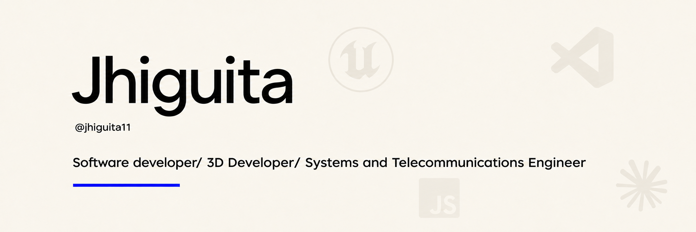

---

##  Sobre mí

-  Desarrollador Full Stack especializado en crear sitios web y aplicaciones, desde el diseño de la interfaz hasta la lógica del servidor, con enfoque en rendimiento, usabilidad y escalabilidad.
-  Creo **experiencias 3D, VR y AR** en **Unreal Engine 5** y **Unity 6**.
-  Modelado y animación 3D con Blender, 3ds Max y Twinmotion.
-  Uso **inteligencia artificial** (Claude y Codex) en mi flujo de trabajo para programar, prototipar y crear más rápido.
-  Siempre aprendiendo nuevas tecnologías.
-  Puedes ver mi trabajo en mi [portafolio](https://jhiguita11.github.io/Portafolio/).

##  Habilidades

### Desarrollo de Experienicas Inmersivas

### 3D / Animación

### Programación

  

### Edición

  

### Inteligencia Artificial

  
  

##  Proyectos destacados

| Proyecto | Descripción | Tecnología |
|---|---|---|
| [Orbital](https://github.com/Jhiguita11/Orbital) | Software interno para empresa | JavaScript,Vue,HTML,CSS,JSON,SVG,PowerShell,NSIS,Vue 3,Vue Router,Vite,Electron,Node.js,electron-builder,hls.js,exceljs,qrcode,lucide-vue-next,Supabase,Google Sheets,Claude Code|
| [Reserva_Mirrinao](https://github.com/Jhiguita11/Reserva_Mirrinao) | Recorrido 360 para constructora | Next.js 16 (con Turbopack),React 19,TypeScript,Tailwind CSS 4,Pannellum,Zustand,Lucide React,Radix UI,Sharp, Playwright,PowerShell,ESLint,npm / Bun,Git, Claude Code|
| [Portafolio](https://github.com/Jhiguita11/Portafolio) | Mi portafolio personal | JavaScript,CSS,React 19 (con JSX),React DOM,Framer Motion,React Icons,EmailJS,web-vitals,React Context API (para el i18n ES/EN),Web Audio API,Variables CSS,Jest,React Testing Library,Bun,npm,GitHub Actions,GitHub Pages,GitHub Packages,Google Fonts,Meta tags de Open Graph,Claude Code |
| [Gellato-alla-crema](https://github.com/Jhiguita11/Gelato-Alla-Crema) | Software interno para heladeria | HTML |

##  Estadísticas

  
  
   
  

